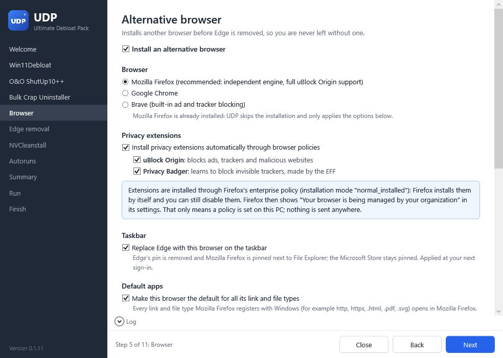

<div align="center">


# Ultimate Debloat Pack

**One wizard to debloat Windows 11 and 10, using only official tools.**

[](https://github.com/HamidDidNotEat/Ultimate-Debloat-Pack/releases/latest)
[](https://github.com/HamidDidNotEat/Ultimate-Debloat-Pack/actions/workflows/tests.yml)
[](LICENSE)


[Website](https://hamiddidnoteat.github.io) &middot;
[Quick start](#quick-start) &middot;
[Features](#features) &middot;
[What's included](#whats-included) &middot;
[Safety](#safety-and-verification) &middot;
[Undo](#how-to-undo) &middot;
[FAQ](#faq) &middot;
[Contributing](CONTRIBUTING.md)

</div>

---

Ultimate Debloat Pack (UDP) runs a set of well-known debloat and privacy tools for you, one after another, from their official sources. A wizard explains each tool in plain language, you tick what you want, and UDP does the rest, so the whole process feels like a single app.

> [!WARNING]
> UDP changes system settings, removes apps and can remove Microsoft Edge. It creates a restore point first, but some of these changes cannot be undone by UDP itself. **Use it at your own risk:** UDP and the authors of the tools it runs give no warranty.

| Welcome | A tool page | During the run |
|:---:|:---:|:---:|
|  |  |  |

## Quick start

Open **PowerShell** as a normal user and run:

```powershell
irm https://hamiddidnoteat.github.io/udp | iex
```

UDP asks for administrator rights itself. The short command loads [`Get.ps1`](Get.ps1) from this repository, which:
- downloads the [latest release](https://github.com/HamidDidNotEat/Ultimate-Debloat-Pack/releases/latest)
- checks it against the `SHA256SUMS` file published with it
- starts UDP, and deletes the extracted files when UDP closes

Website: **https://hamiddidnoteat.github.io**

<details>
<summary>Other ways to start UDP</summary>

**Straight from GitHub,** without the website (same `Get.ps1`):

```powershell
irm https://raw.githubusercontent.com/HamidDidNotEat/Ultimate-Debloat-Pack/main/Get.ps1 | iex
```

**Download and double-click:** download `UDP.zip` from the [latest release](https://github.com/HamidDidNotEat/Ultimate-Debloat-Pack/releases/latest), extract it, and double-click `Run-UDP.bat`.

**From a PowerShell window**, inside the extracted folder:

```powershell
powershell.exe -NoProfile -ExecutionPolicy Bypass -File .\UDP.ps1                         # wizard
powershell.exe -NoProfile -ExecutionPolicy Bypass -File .\UDP.ps1 -DryRun                 # preview only
powershell.exe -NoProfile -ExecutionPolicy Bypass -File .\UDP.ps1 -RevertBrowserPolicies  # undo extension policies
```

`-ExecutionPolicy Bypass` applies to that one process only; UDP never changes your system's execution policy.

</details>

**Requirements:** Windows 11, or Windows 10 for the tools that support it; Windows PowerShell 5.1 (built into Windows, PowerShell 7 is not needed); an internet connection; administrator rights. winget (App Installer) is recommended. Without it, UDP uses official direct downloads where they exist.

## Features

- **One app, one flow.** Every tool gets a page explaining what it does, what it changes, the risks and how to undo it. You choose; UDP runs everything in the right order.
- **Official sources only.** Nothing third-party is bundled. Every tool is downloaded at run time from the address in [`config/tools.json`](config/tools.json).
- **Verified before it runs.** Digital signatures are checked against the expected publisher, and published SHA256 checksums are compared. A tool that fails its check is skipped, and the reason is logged.
- **Safety net first.** A System Restore point is created before any change. A failed step never crashes the run: UDP asks whether to continue or stop.
- **Dry run.** See exactly what would happen, without changing anything.
- **One window at a time.** Silent tools run hidden with their output in UDP's log panel. Interactive tools get a short guide first, and UDP continues by itself when you close them.
- **One restart.** The tools' own restart prompts are suppressed; you restart once at the end.
- **Before/after report.** UDP measures the PC when it starts and once more after the restart, then shows what changed: processes, RAM, services, startup entries, programs, apps and disk space.
- **Readable code.** Windows PowerShell 5.1 and WPF, no external modules, no obfuscation, tested in CI.

## What's included

| Step | Tool | What it does | Mode | Default |
|:---:|------|--------------|------|:---:|
| 1 | [Win11Debloat](https://github.com/Raphire/Win11Debloat) by Raphire | Removes preinstalled Store apps; turns off telemetry, ads, suggestions, Copilot, Recall and more | Silent: recommended defaults or your own choice | On |
| 2 | [O&O ShutUp10++](https://www.oo-software.com/en/shutup10) | One list of Windows privacy settings, each with a recommendation | You choose in its window, or silent with your exported settings | On |
| 3 | [Bulk Crap Uninstaller](https://github.com/BCUninstaller/Bulk-Crap-Uninstaller) | Uninstalls desktop programs in bulk and cleans their leftovers | Interactive only: UDP never uninstalls anything by itself | On |
| 4 | [Firefox](https://www.mozilla.org/firefox/), [Chrome](https://www.google.com/chrome/) or [Brave](https://brave.com/) | Installs a browser, optionally with uBlock Origin (Lite) and Privacy Badger | Silent, then you confirm the default browser | On |
| 5 | [UninstallEdge.ps1](https://gist.github.com/ave9858/c3451d9f452389ac7607c99d45edecc6) by ave9858 | Removes Microsoft Edge in any country with Edge's own uninstaller, keeping WebView2 | Silent | Off |
| 6 | [NVCleanstall](https://www.techpowerup.com/nvcleanstall/) by TechPowerUp | Installs the NVIDIA driver with only the parts you choose | Interactive, NVIDIA GPUs only | Off |
| 7 | [Autoruns](https://learn.microsoft.com/sysinternals/downloads/autoruns) by Microsoft Sysinternals | Shows everything that starts with Windows so you can switch entries off | Interactive review | On |

Every tool has its own page in [`docs/`](docs/README.md).

## How it works


- **Bulk Crap Uninstaller after Win11Debloat:** the program list is already shorter.
- **Bulk Crap Uninstaller before the new browser:** the browser cannot be removed by mistake.
- **Edge removal after the browser:** you are never left without a browser.
- **Autoruns last:** it only shows the startup entries left after all uninstalls.

More in [docs/order-of-operations.md](docs/order-of-operations.md).

## Safety and verification

| Tool | Source | Check before running |
|------|--------|----------------------|
| Win11Debloat | GitHub release `Win11Debloat.zip` | SHA256 from the release's `SHA256SUMS` |
| O&O ShutUp10++ | `dl5.oo-software.com` (winget fallback) | Signed by **O&O Software GmbH** |
| Bulk Crap Uninstaller | GitHub release (portable) or winget | SHA256 digest published by GitHub (BCU is not signed), or winget's hash |
| Firefox / Chrome / Brave | winget (official installer fallback) | winget's hash, or signed by **Mozilla Corporation** / **Google LLC** / **Brave Software, Inc.** |
| UninstallEdge.ps1 | ave9858's gist, pinned to one revision | Pinned SHA256 |
| NVCleanstall | winget (official page fallback) | winget's hash, or signed by **TechPowerUp LLC** |
| Autoruns | `download.sysinternals.com` (winget fallback) | Signed by **Microsoft Corporation** |

- **Logs:** `%ProgramData%\UDP\logs\UDP_<date>_<time>.log`. Win11Debloat's own transcript goes to `%ProgramData%\UDP\logs\Win11Debloat`.
- **Temporary files:** downloads go to `%TEMP%\UDP\work`, which is deleted at the end.
- **Safe to run again** after a Windows feature update. Steps skip what is already done.
- **`%ProgramData%\UDP\state.json`:** remembers what UDP can undo (the browser policies it set) and your last run. Please do not delete it.

## How to undo

| What | How |
|------|-----|
| Everything at once | **System Restore**: Start > "Create a restore point" > System Restore, then pick "UDP (Ultimate Debloat Pack) ..." |
| Win11Debloat | Run Win11Debloat again and restore its registry backup; reinstall apps from the Microsoft Store |
| ShutUp10++ | ShutUp10++ > Actions > Undo all changes |
| Bulk Crap Uninstaller | Reinstall the program, or use the restore point |
| Browser policies (extensions, taskbar, default apps) | Welcome page > "Revert browser policies created by UDP", or `UDP.ps1 -RevertBrowserPolicies` |
| Edge | Reinstall from [microsoft.com/edge](https://www.microsoft.com/edge) |
| NVCleanstall | Install the standard driver from [nvidia.com](https://www.nvidia.com/drivers) |
| Autoruns | Open Autoruns and tick the entry again |

Full guide: [docs/undo.md](docs/undo.md).

## FAQ

<details>
<summary><b>Why can't Edge be uninstalled normally outside the EEA?</b></summary>

Microsoft only lets you uninstall Edge in the European Economic Area, as part of complying with the EU Digital Markets Act. Everywhere else, including Switzerland, the UK and the US, Edge's uninstaller refuses. UDP runs ave9858's `UninstallEdge.ps1`, which starts Edge's own uninstaller in a way it accepts in every country. Up to version 0.1.12, UDP used AveYo's `Edge_Removal.bat`, which cannot remove Edge 120 or newer. See [docs/edge-removal.md](docs/edge-removal.md).
</details>

<details>
<summary><b>What is WebView2 and why is it kept?</b></summary>

WebView2 is a separate copy of the Edge engine that other apps use to show web content: Teams, Outlook, Widgets, many game launchers and installers. Removing it breaks those apps. UDP's Edge step only uninstalls the Edge browser, leaves WebView2 and its updater alone, and checks afterwards that WebView2 is still there.
</details>

<details>
<summary><b>Will Edge come back?</b></summary>

It can, after a major Windows feature update. Run UDP again: the Edge step skips itself when Edge is not installed. A few Windows links (some search results, widgets, help links) only open in Edge; without it, Windows says it needs an app to open them.
</details>

<details>
<summary><b>Why only one restart?</b></summary>

Several tools change settings that only apply after a restart. Restarting after each tool would interrupt the run and could leave a half-finished state, so UDP suppresses the tools' own restart prompts and asks you once at the end.
</details>

<details>
<summary><b>What do I lose without the NVIDIA App (NVCleanstall)?</b></summary>

DLSS Override, ShadowPlay (Instant Replay and recording) and Smooth Motion. NVIDIA Profile Inspector covers per-game driver settings and OBS Studio covers recording. You can install the NVIDIA App again at any time.
</details>

<details>
<summary><b>What are "managed" browser extensions?</b></summary>

With "Install privacy extensions" ticked, UDP sets the browser's own enterprise policy `ExtensionSettings` in `HKLM\SOFTWARE\Policies`. The browser installs the extensions by itself and shows "managed by your organization". That only means a policy is set on this PC; nothing is sent anywhere. UDP uses the mode `normal_installed`, so you can still disable the extensions.

- In Chrome, uBlock Origin no longer works (Manifest V2 was removed), so UDP installs uBlock Origin Lite.
- Brave already blocks ads with Shields, so extensions are off by default there.
</details>

<details>
<summary><b>Win11Debloat vs Bulk Crap Uninstaller: which removes what?</b></summary>

- **Win11Debloat** removes built-in **Store (Appx) apps** that come with Windows (games, news, weather, Copilot and similar) and changes settings.
- **Bulk Crap Uninstaller** removes classic **desktop programs** (OEM tools, trial antivirus, old software) and cleans their leftovers.

They complement each other. UDP never uninstalls anything in BCU by itself.
</details>

<details>
<summary><b>My antivirus complains about the Edge removal step.</b></summary>

Edge removal scripts change protected parts of Windows, which some security products flag. The script UDP uses also starts Edge's uninstaller from a temporary copy of `cmd.exe` named `dllhost.exe` in `C:\Windows\SystemTemp`, which can look suspicious; it is deleted right afterwards. UDP only runs the exact file pinned in `tools.json`, checked by SHA256. If the step is blocked, it is marked as failed and the rest of the run continues.
</details>

<details>
<summary><b>Can I use ShutUp10++ silently?</b></summary>

Yes, with your own settings. O&O does not publish the file format, so UDP ships no settings file and invents no setting IDs. Run ShutUp10++ once in its window, set it up the way you like, use *File > Export settings*, and save the file as `config\ooshutup10.cfg`. The "Silent" option then becomes available.
</details>

## Configuration

[`config/tools.json`](config/tools.json) holds every external source: name, description, official URL, winget ID, expected signer, integrity method, license and homepage, plus the Win11Debloat option list and the browser extension IDs. Updating a link only requires editing this file. The Edge removal script is pinned to one gist revision: change `url`, `revision`, `revisionDate` and `sha256` together.

## Development

```text
UDP.ps1               entry point: elevation, checks, wizard
Run-UDP.bat           double-click launcher
Get.ps1               one-liner bootstrap (verifies the release zip)
config/tools.json     every external source, ID, signer and checksum
src/Core/             logging, downloads, integrity checks, winget, runner
src/Steps/            one file per tool, in execution order
src/UI/Wizard.ps1     WPF wizard logic
ui/                   XAML window, pages, styles and logo
tests/Test-UDP.ps1    self-tests, also run in CI on every push
docs/                 one page per tool, order of operations, undo guide
```

Run the self-tests (they change nothing):

```powershell
powershell.exe -NoProfile -ExecutionPolicy Bypass -STA -File .\tests\Test-UDP.ps1 -Online
```

See [CONTRIBUTING.md](CONTRIBUTING.md) for the coding rules, how to update a tool source and how releases are made.

## Roadmap

Planned for the next `v0.1.x` releases:

- [x] Edge removal: reliable result check (v0.1.1)
- [x] Edge removal: remove the leftover Edge shortcuts (v0.1.2)
- [x] Clearer step-by-step guides for the tools you work in (v0.1.3)
- [x] Autoruns: what is usually safe to switch off (v0.1.4)
- [x] Win11Debloat: choose exactly which apps to remove (v0.1.5)
- [x] Browser: replace Edge on the taskbar with the new browser (v0.1.6)
- [x] Browser: make it the default for every web file and link type (v0.1.7)
- [x] Before/after report after the restart (v0.1.8)
- [x] Edge removal that works with Edge 120 and newer (v0.1.13)

See the [CHANGELOG](CHANGELOG.md) for what each release changed.

## Credits

UDP only orchestrates other people's work. All credit for the tools goes to their authors:

- [Win11Debloat](https://github.com/Raphire/Win11Debloat) by Raphire (MIT)
- [O&O ShutUp10++](https://www.oo-software.com/en/shutup10) by O&O Software GmbH (freeware)
- [Bulk Crap Uninstaller](https://github.com/BCUninstaller/Bulk-Crap-Uninstaller) by Marcin Szeniak / Klocman ([bcuninstaller.com](https://www.bcuninstaller.com/), Apache-2.0)
- [UninstallEdge.ps1](https://gist.github.com/ave9858/c3451d9f452389ac7607c99d45edecc6) by ave9858 (CC0, public domain). Versions up to 0.1.12 used [Edge_Removal.bat](https://github.com/AveYo/fox) by AveYo.
- [NVCleanstall](https://www.techpowerup.com/nvcleanstall/) by TechPowerUp (freeware)
- [Autoruns](https://learn.microsoft.com/sysinternals/downloads/autoruns) by Mark Russinovich, Microsoft Sysinternals ([license](https://learn.microsoft.com/sysinternals/license-terms))
- [Mozilla Firefox](https://www.mozilla.org/firefox/), [Google Chrome](https://www.google.com/chrome/), [Brave](https://brave.com/)
- [uBlock Origin](https://github.com/gorhill/uBlock) and [uBlock Origin Lite](https://github.com/uBlockOrigin/uBOL-home) by Raymond Hill; [Privacy Badger](https://privacybadger.org/) by the EFF

## License

UDP's own code is released under the [MIT License](LICENSE).

Every tool UDP runs keeps its own license, and UDP downloads each one from its official source at run time; none of them is redistributed in this repository. When winget installs a package, UDP passes `--accept-package-agreements`: clicking Start on the summary page means you accept the license of each tool you selected.
